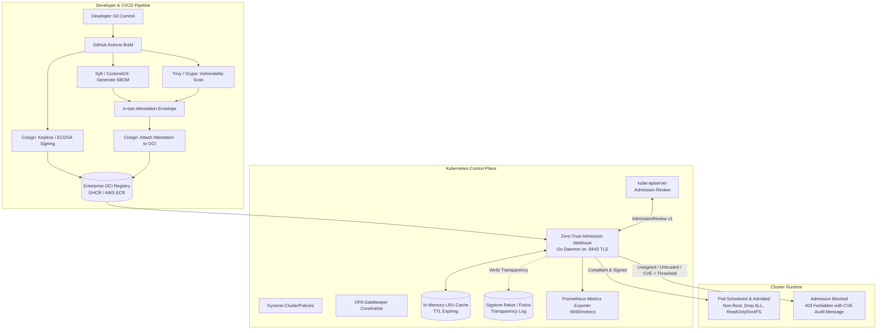
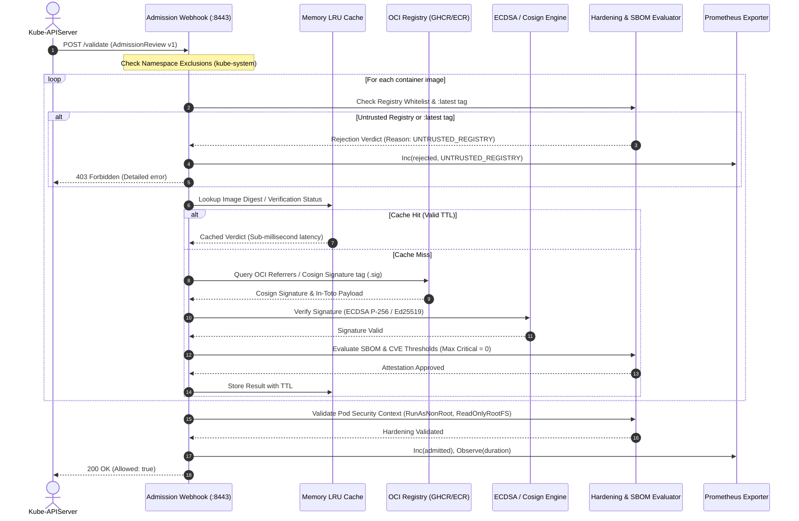

# Zero-Trust Software Supply Chain Security Architecture

This document details the architectural design, verification lifecycle, cryptographic trust models, and threat prevention mechanisms implemented in `zero-trust-supply-chain-webhook`.

---

## 1. High-Level Architecture

The platform establishes an end-to-end cryptographic trust chain from source code commit through CI/CD artifact creation down to Kubernetes cluster runtime admission.

---

## 2. Cryptographic Verification Sequence

Every incoming pod creation or update request traverses an optimized, multi-tier evaluation pipeline:

---

## 3. Policy Engine Comparison

The platform provides dual operational pathways: a high-throughput **Native Go Admission Webhook daemon** and **declarative Kyverno / OPA Gatekeeper policies**.

| Capability | Native Go Webhook (`cmd/webhook`) | Kyverno (`policies/kyverno`) | OPA Gatekeeper (`policies/opa`) |
| :--- | :--- | :--- | :--- |
| **Performance & Latency** | **Sub-millisecond** with in-memory LRU caching | Fast (~5-15ms) | Standard (~10-25ms) |
| **Cosign Verification** | Native ECDSA / Ed25519 & Sigstore Keyless | Built-in `verifyImages` stanza | Via Rego extension / external data |
| **In-Toto SBOM Analysis** | Built-in JSON / in-toto predicate parser | Native attestation matching | Custom Rego rule parsing |
| **Audit vs. Enforce** | Configurable via `policy.mode` (`enforce`\|`audit`) | `validationFailureAction: Enforce` | `enforcementAction: deny\|dryrun` |
| **Metrics & Telemetry** | Native Prometheus histograms on `:9090` | Kyverno Prometheus metrics | Gatekeeper Prometheus metrics |
| **Resource Footprint** | Extremely lightweight (< 25MB RAM) | Standard Controller (< 150MB) | Standard Controller (< 200MB) |

---

## 4. Threat Matrix & Mitigations (SLSA Level 3 Alignment)

| Threat Vector | Attack Scenario | Prevention Mechanism in Webhook |
| :--- | :--- | :--- |
| **Supply Chain Tampering** | Attacker modifies image in transit or registry compromised | Cosign cryptographic signature verification validates image digest against tamper-proof key. |
| **Compromised Registry / Typosquatting** | Attacker deploys malicious image from unauthorized DockerHub repo | Strict **Registry Whitelisting** with wildcard matching blocks any non-approved OCI domain. |
| **Tag Mutability Attack** | Attacker overwrites `app:v1.0` or pushes malicious `:latest` | **Tag Immutability & Anti-Latest Enforcement** blocks mutable tags and mandates cryptographic SHA256 pinning. |
| **Known Exploitable CVEs** | Deployment of containers with known Log4j, OpenSSL, or kernel zero-days | **In-Toto Attestation Engine** parses scanner outputs (Trivy/Grype) and blocks images exceeding CVE thresholds. |
| **Container Breakout / Privilege Escalation** | Container runs as root, mounts root filesystem as writable, or requests `CAP_SYS_ADMIN` | **Pod Security Validator** enforces non-root execution (`runAsNonRoot: true`), `readOnlyRootFilesystem: true`, and dropping all capabilities (`drop: ["ALL"]`). |
