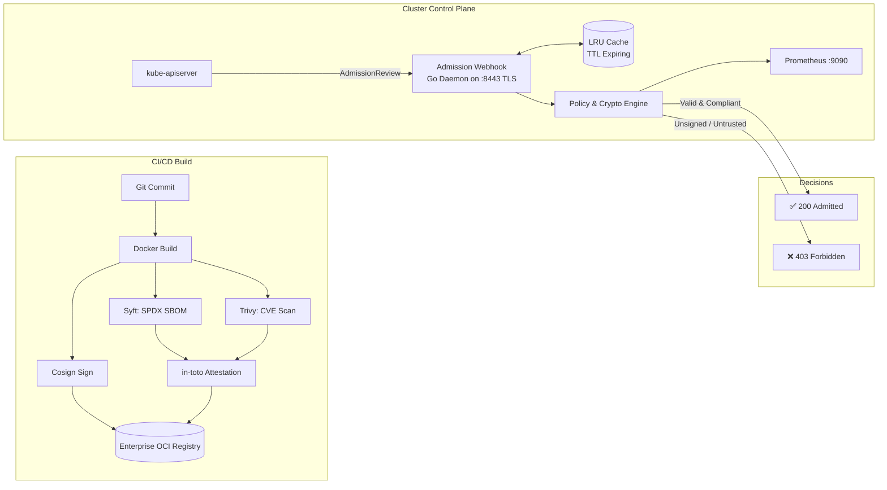

<div align="center">

# 🛡️ Zero-Trust Software Supply Chain & Admission Webhook

**Enterprise Kubernetes Validating Admission Controller, Sigstore Cosign Verifier, in-toto SBOM & Vulnerability Attestation Engine, and Policy-as-Code Framework (Go + Kyverno + OPA Gatekeeper)**

[](https://golang.org)
[](https://kubernetes.io)
[](https://sigstore.dev)
[](https://kyverno.io)
[](https://open-policy-agent.github.io/gatekeeper/)
[](https://slsa.dev)
[](LICENSE)

<br/>

<p align="center">
  <b>A zero-trust cryptographic guardian for cloud-native container workloads.</b><br/>
  Enforcing end-to-end provenance, image signature verification, SBOM compliance, CVE thresholds, and pod hardening before a single container executes on your cluster.
</p>

</div>

---

## 📑 Table of Contents

- [Overview](#-overview)
- [Key Features](#-key-features)
- [Architecture & Verification Pipeline](#-architecture--verification-pipeline)
- [Multi-Tier Policy Enforcement](#-multi-tier-policy-enforcement)
- [Quickstart: KinD Cluster E2E Demo](#-quickstart-kind-cluster-e2e-demo)
- [Helm v3 Deployment](#-helm-v3-deployment)
- [Observability & Metrics](#-observability--metrics)
- [Repository Structure](#-repository-structure)
- [SLSA Level 3 & Threat Model](#-slsa-level-3--threat-model)
- [Author & License](#-author--license)

---

## 🌟 Overview

In modern cloud-native architectures, standard CI/CD pipelines are vulnerable to **supply chain tampering, malicious dependency injection, typosquatting, and mutable tag overwriting**. 

`zero-trust-supply-chain-webhook` bridges the trust gap between build artifacts and runtime execution:
1. **At Build Time:** Generates cryptographic Software Bill of Materials (SBOM via Syft/SPDX), scans for CVEs (Trivy), signs the container image using **Sigstore Cosign**, and generates SLSA Level 3 provenance.
2. **At Admission Time:** A high-throughput, low-latency **Kubernetes Validating Admission Webhook daemon (written in Go)** intercepts `Pod` creation requests, verifies signatures and in-toto attestations against enterprise keys, validates pod hardening, and denies unverified workloads with `403 Forbidden`.
3. **Policy-as-Code Portability:** Accompanied by full production-grade **Kyverno ClusterPolicies** and **OPA Gatekeeper (Rego)** constraint templates, enabling platform teams to run either the native high-performance Go daemon or standard policy controllers.

---

## 🚀 Key Features

* **🔏 Cryptographic Cosign Verification:**
  * Supports standard ECDSA P-256 / Ed25519 PEM keys and Keyless signing (Sigstore Fulcio/Rekor OIDC transparency logs).
  * High-concurrency, thread-safe **in-memory LRU cache with TTL** delivering sub-millisecond admission evaluation.
* **📦 SBOM & In-Toto Attestation Engine:**
  * Validates presence of SPDX / CycloneDX SBOMs attached via OCI referrers.
  * Enforces maximum allowed CVE thresholds (e.g. `maxCriticalCVEs: 0`, `maxHighCVEs: 2`).
* **🌐 Enterprise Registry Whitelisting:**
  * Granular wildcard pattern matching (e.g., `ghcr.io/ekrmcakir/*`, `*.dkr.ecr.eu-west-1.amazonaws.com/*`). Blocks rogue public registries and DockerHub.
* **🚫 Tag Immutability & Anti-Latest Policy:**
  * Strictly forbids mutable `:latest` tags or unpinned images, requiring cryptographic digest pinning (`@sha256:...`).
* **🛡️ Pod Security Standards (PSS) Hardening:**
  * Enforces container isolation: `runAsNonRoot: true`, `readOnlyRootFilesystem: true`, `allowPrivilegeEscalation: false`, and `capabilities.drop: ["ALL"]`.
* **⚖️ Enforce vs. Audit Modes:**
  * Toggle between strictly blocking violators or operating in dry-run/audit mode with Prometheus telemetry and admission warnings.
* **📊 Prometheus & Grafana Telemetry:**
  * Real-time metrics for admission rates, rejection causes, cache hits/misses, and latency percentiles (p50, p95, p99). Includes pre-built dark-mode Grafana dashboard.

---

## 🏗️ Architecture & Verification Pipeline



For comprehensive sequence diagrams and deep architectural specifications, see [ARCHITECTURE.md](ARCHITECTURE.md).

---

## 📋 Multi-Tier Policy Enforcement

| Security Control | Go Webhook Daemon | Kyverno ClusterPolicy | OPA Gatekeeper (Rego) |
| :--- | :---: | :---: | :---: |
| **Cosign Signature Check** | ✅ Native ECDSA/Sigstore | ✅ `verifyImages` | ✅ Custom Constraint |
| **SBOM & In-Toto Attestation** | ✅ JSON Predicate Parser | ✅ `attestations` | ✅ Rego Attestation Filter |
| **Registry Whitelist** | ✅ Wildcard Matcher | ✅ `pattern.containers.image` | ✅ `K8sTrustedRegistries` |
| **Anti-Latest Tag Enforcement** | ✅ Tag Parser | ✅ Pattern negation | ✅ `K8sRequiredDigest` |
| **Pod Security Hardening** | ✅ PSS Baseline Checker | ✅ Restricted Profile | ✅ Gatekeeper PSS Library |
| **In-Memory Cache (Sub-ms)** | ✅ Integrated LRU | ❌ Registry dependent | ❌ Controller dependent |

---

## ⚡ Quickstart

### 🎮 Option A: Zero-Cluster Local Simulation & Web Dashboard
You can evaluate the full Zero-Trust admission pipeline, live Prometheus telemetry, and the interactive web console directly on your machine without needing a running Kubernetes cluster:

```bash
# 1. Run interactive CLI simulation (tests 6 real admission attacks)
./scripts/demo-live.sh

# 2. Start persistent Webhook Daemon & open the Web Console & Grafana preview
./scripts/start-server.sh
open http://localhost:9090

# 3. Inspect interactive code test coverage heat map
open coverage.html
```

---

### ☸️ Option B: Real KinD Cluster E2E Deployment

#### 1. Prerequisites
* Go 1.24+ (`go version`)
* Docker & [KinD](https://kind.sigs.k8s.io/)
* `kubectl` and `openssl`

### 2. Generate Development TLS Certificates & Test Keys
```bash
# Generate Webhook TLS certs
bash scripts/generate-certs.sh certs zero-trust-system zero-trust-webhook

# Generate sample Cosign ECDSA P-256 keypair
bash scripts/generate-cosign-keys.sh examples/cosign-test-keys
```

### 3. Launch KinD Cluster & Deploy
```bash
# Create cluster
kind create cluster --name zero-trust-demo

# Build local Docker image and load into KinD
docker build -t zero-trust-webhook:local .
kind load docker-image zero-trust-webhook:local --name zero-trust-demo

# Deploy namespace, RBAC, configmap, and TLS secret
kubectl apply -f deploy/manifests/00-namespace.yaml
kubectl apply -f deploy/manifests/01-rbac.yaml
kubectl apply -f deploy/manifests/02-configmap.yaml
kubectl create secret tls zero-trust-webhook-tls --cert=certs/tls.crt --key=certs/tls.key -n zero-trust-system

# Deploy Webhook daemon
kubectl apply -f deploy/manifests/04-deployment.yaml
kubectl set image deployment/zero-trust-webhook webhook=zero-trust-webhook:local -n zero-trust-system
kubectl set image-pull-policy deployment/zero-trust-webhook webhook=Never -n zero-trust-system

# Register ValidatingWebhookConfiguration with CA bundle
CA_BUNDLE=$(cat certs/ca.crt | base64 | tr -d '\n')
sed -i.bak "s|caBundle:.*|caBundle: ${CA_BUNDLE}|g" deploy/manifests/06-webhook-config.yaml
kubectl apply -f deploy/manifests/06-webhook-config.yaml

# Verify webhook status
kubectl rollout status deployment/zero-trust-webhook -n zero-trust-system
```

---

## 🧪 Testing Policy Scenarios

### Test 1: Admitting a Compliant, Signed Pod
```bash
kubectl apply -f examples/valid-signed-production-pod.yaml
# Output: pod/payment-service-compliant created
```

### Test 2: Rejecting an Unsigned Image
```bash
kubectl apply -f examples/invalid-unsigned-pod.yaml
# Output:
# Error from server (Forbidden): admission webhook "validate.supplychain.zerotrust.io" denied the request:
# [Zero-Trust Policy Violation] Image 'ghcr.io/ekrmcakir/unsigned-service:v1.0.0' failed Cosign verification: No Cosign signature found in OCI registry
```

### Test 3: Rejecting Mutable `:latest` Tag
```bash
kubectl apply -f examples/invalid-latest-tag-pod.yaml
# Output:
# Error from server (Forbidden): admission webhook "validate.supplychain.zerotrust.io" denied the request:
# [Zero-Trust Policy Violation] Image 'ghcr.io/ekrmcakir/signed-app:latest' uses mutable or implicit ':latest' tag, which violates tag immutability policy
```

### Test 4: Rejecting Untrusted Public Registry
```bash
kubectl apply -f examples/invalid-untrusted-registry-pod.yaml
# Output:
# Error from server (Forbidden): admission webhook "validate.supplychain.zerotrust.io" denied the request:
# [Zero-Trust Policy Violation] Image 'docker.io/malicious-org/crypto-miner:v1.2.0' is from an untrusted registry. Allowed registries: [ghcr.io/ekrmcakir/* *.dkr.ecr.*.amazonaws.com/*]
```

---

## ☸️ Helm v3 Deployment

The production-ready Helm v3 chart packages all components:

```bash
# Install with custom values
helm install zero-trust-webhook ./charts/zero-trust-webhook \
  --namespace zero-trust-system \
  --create-namespace \
  --set policy.mode=enforce \
  --set autoscaling.enabled=true \
  --set serviceMonitor.enabled=true
```

---

## 📊 Observability & Metrics

The webhook exposes standard Prometheus metrics on `:9090/metrics`:

| Metric Name | Type | Description |
| :--- | :--- | :--- |
| `supply_chain_admission_validations_total` | Counter | Total admission reviews partitioned by `verdict`, `reason`, and `namespace`. |
| `supply_chain_admission_validation_duration_seconds` | Histogram | Latency distribution of admission decisions across execution modes. |
| `supply_chain_policy_violations_total` | Counter | Breakdown of security violations detected (`UNTRUSTED_REGISTRY`, `COSIGN_SIGNATURE_MISSING`, etc.). |
| `supply_chain_cache_cosign_hits_total` | Counter | Cache hits for in-memory signature verification. |
| `supply_chain_policy_enforcement_mode` | Gauge | Active mode: `1` for Enforce, `0` for Audit. |

A pre-built Grafana dashboard is included at [`dashboards/grafana-supply-chain.json`](dashboards/grafana-supply-chain.json).

---

## 📁 Repository Structure

```text
zero-trust-supply-chain-webhook/
├── .github/workflows/          # Production CI/CD, Cosign signing, KinD E2E, SLSA 3
├── cmd/webhook/                # Webhook daemon entrypoint & CLI flags
├── pkg/
│   ├── common/                 # Core types, errors, and validation reasons
│   ├── config/                 # YAML configuration parser & registry matcher
│   ├── verifier/               # Cosign ECDSA crypto, in-memory LRU cache, SBOM analyzer
│   ├── policy/                 # Policy Engine & Pod Security Standards validator
│   ├── webhook/                # HTTP TLS server, AdmissionReview v1 handler
│   └── metrics/                # Prometheus metrics instrumentation
├── policies/
│   ├── kyverno/                # Kyverno ClusterPolicies (Cosign, SBOM, PSS)
│   └── opa/                    # OPA Gatekeeper ConstraintTemplates & Constraints
├── charts/zero-trust-webhook/  # Production Helm v3 chart
├── deploy/manifests/           # Plain kubectl deployment manifests (00-06)
├── examples/                   # Compliant and violating Pod test manifests
├── dashboards/                 # Pre-configured Grafana dashboard JSON
├── scripts/                    # Certificate & Cosign key generators
├── ARCHITECTURE.md             # Detailed architecture & sequence diagrams
├── Dockerfile                  # Hardened distroless multi-stage container
└── Makefile                    # Build, test, lint, and run automation
```

---

## 🔒 SLSA Level 3 & Threat Model

This repository is aligned with the **Supply-chain Levels for Software Artifacts (SLSA) Level 3** specification:
1. **Source Integrity:** Monitored branch protection with verified Git commit signatures.
2. **Build Isolation:** Builds executed in isolated GitHub-hosted runners using verified Docker Buildx actions.
3. **Cryptographic Provenance:** Automatic generation of non-falsifiable in-toto provenance statements via `slsa-framework/slsa-github-generator`.
4. **Runtime Admission Enforcement:** Pods running on Kubernetes are cryptographically proven to have originated from the verified pipeline before being scheduled.

---

## 👤 Author

* **Ekrem Cakir** — [GitHub Profile (@ekrmcakir)](https://github.com/ekrmcakir)
* **Domain Focus:** Cloud Architecture, Platform Engineering, DevSecOps & Zero-Trust Infrastructure

---

## 📄 License

Licensed under the [Apache License, Version 2.0](LICENSE).
